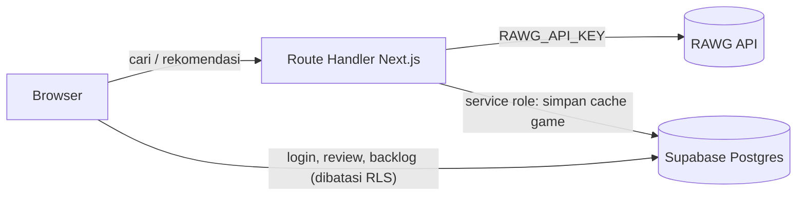
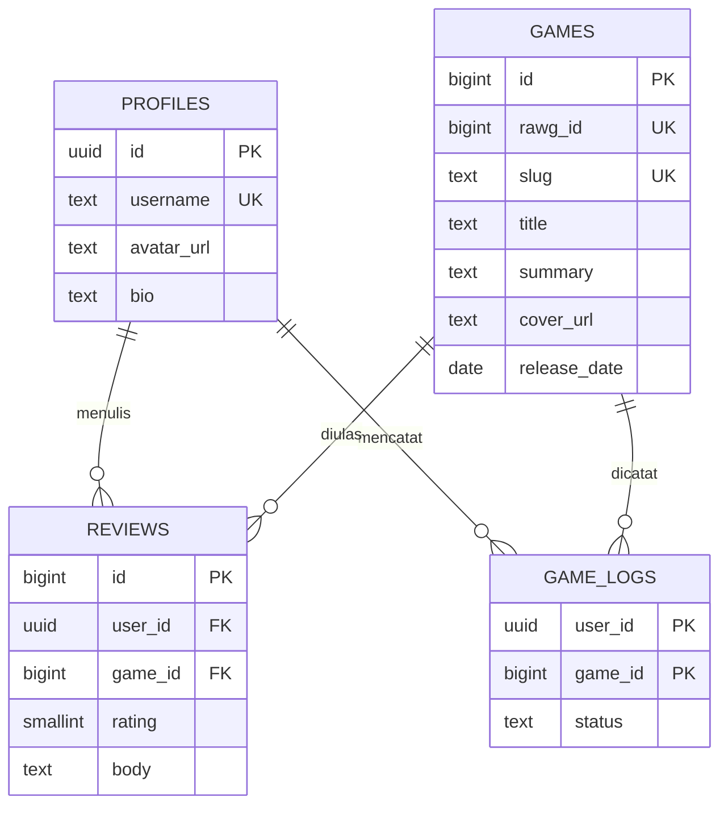

# Gimilog

Web review game tempat gamer menulis ulasan, memberi rating, dan mencatat backlog game yang ingin, sedang, atau sudah dimainkan.

> Demo: _tambahkan tautan Vercel setelah deploy_

## Daftar Isi

- [Latar Belakang](#latar-belakang)
- [Fitur](#fitur)
- [Tech Stack](#tech-stack)
- [Arsitektur](#arsitektur)
- [Struktur Proyek](#struktur-proyek)
- [Menjalankan Secara Lokal](#menjalankan-secara-lokal)
- [Environment Variables](#environment-variables)
- [Skema Database](#skema-database)
- [Routes dan Endpoint](#routes-dan-endpoint)
- [Aturan untuk Kontributor](#aturan-untuk-kontributor)
- [Deploy](#deploy)
- [Pengembangan Selanjutnya](#pengembangan-selanjutnya)
- [Atribusi](#atribusi)

## Latar Belakang

**Masalah:** gamer memiliki banyak game, tetapi bingung mana yang sudah, sedang, atau belum dimainkan, dan bingung memilih game berikutnya.

**Solusi:** Gimilog menggabungkan tiga hal dalam satu tempat:

1. **Pencatat backlog** dengan status *wishlist*, *playing*, dan *finished*.
2. **Review dan rating** untuk game yang sudah dimainkan.
3. **Rekomendasi** berdasarkan genre, platform, rating, dan durasi, supaya pengguna tidak lagi bingung memilih.

Data game diambil otomatis dari [RAWG API](https://rawg.io/apidocs), sehingga pengguna tidak perlu mengisi data game secara manual.

## Fitur

| Fitur | Deskripsi |
|---|---|
| Autentikasi | Daftar, login, dan logout dengan email dan password |
| Pencarian game | Cari berdasarkan judul, dengan data dari RAWG |
| Detail game | Info game, rata-rata rating, dan semua review |
| Review dan rating | Rating 1-5 dan teks. Satu review per user per game, bisa diedit dan dihapus pemiliknya |
| Backlog | Tandai game sebagai wishlist, playing, atau finished |
| Profil publik | `/u/[username]` menampilkan review dan backlog user |
| Rekomendasi | Filter genre, platform, rating minimal, dan durasi, plus tombol "Kejutkan aku" |

## Tech Stack

| Lapisan | Teknologi |
|---|---|
| Framework | [Next.js](https://nextjs.org) (App Router) di atas React, TypeScript |
| Styling dan UI | Tailwind CSS, [shadcn/ui](https://ui.shadcn.com) |
| Backend dan database | [Supabase](https://supabase.com) (Postgres, Auth, Row Level Security) |
| Data fetching | TanStack Query |
| Form dan validasi | React Hook Form, Zod |
| Sumber data game | RAWG API |
| Hosting | Vercel |

**Mengapa Next.js:** kunci RAWG dan *service role key* Supabase harus berjalan di sisi server dan tidak boleh sampai ke browser. Next.js menyediakan Route Handler dan Server Component untuk itu, sementara seluruh komponen tetap ditulis dengan React.

## Arsitektur



**Pola cache-first.** Data game dari RAWG disimpan ke tabel `games` saat pertama kali muncul di hasil pencarian atau rekomendasi. Detail game (deskripsi) diambil dari RAWG sekali, lalu dibaca dari database sendiri pada kunjungan berikutnya.

**Tiga client Supabase dengan hak akses berbeda:**

| File | Identitas | Kena RLS? | Dipakai untuk |
|---|---|---|---|
| `lib/supabase/client.ts` | User login (browser) | Ya | Review, backlog, login di komponen client |
| `lib/supabase/server.ts` | User login (cookie) | Ya | Membaca data di Server Component |
| `lib/supabase/admin.ts` | Sistem (service role) | **Tidak** | Menyimpan data game dari RAWG |

## Struktur Proyek

```
gimilog/
├── src/
│   ├── app/
│   │   ├── api/games/
│   │   │   ├── search/route.ts          # GET pencarian game
│   │   │   └── recommend/route.ts       # GET rekomendasi game
│   │   ├── games/[slug]/page.tsx        # Detail game, review, backlog
│   │   ├── u/[username]/page.tsx        # Profil publik
│   │   ├── search/page.tsx              # Pencarian
│   │   ├── rekomendasi/page.tsx         # Rekomendasi
│   │   ├── login/page.tsx
│   │   ├── register/page.tsx
│   │   ├── layout.tsx
│   │   ├── page.tsx                     # Beranda
│   │   └── providers.tsx                # TanStack Query provider
│   ├── components/
│   │   ├── ui/                          # Komponen shadcn/ui
│   │   └── Navbar.tsx
│   ├── features/                        # Kode dikelompokkan per fitur
│   │   ├── auth/components/             # AuthForm, LogoutButton
│   │   ├── games/
│   │   │   ├── constants.ts             # Daftar genre dan platform
│   │   │   ├── hooks/                   # useGameSearch, useRecommendations
│   │   │   └── services/games.service.ts
│   │   ├── logs/components/             # LogButtons (backlog)
│   │   └── reviews/components/          # ReviewForm
│   ├── lib/
│   │   ├── supabase/                    # client, server, admin, proxy
│   │   ├── rawg/                        # client dan mappers
│   │   └── utils.ts
│   ├── proxy.ts                         # Refresh session (middleware.ts di Next.js 15 ke bawah)
│   └── types/database.types.ts          # Dibuat otomatis oleh Supabase CLI
├── supabase/
│   └── migrations/                      # Riwayat skema database
├── langkah.md                           # Panduan membangun dari nol
└── README.md
```

## Menjalankan Secara Lokal

**Prasyarat:** Node.js (LTS), akun [Supabase](https://supabase.com), dan API key [RAWG](https://rawg.io/apidocs).

```bash
# 1. Clone dan install
git clone https://github.com/<username>/gimilog.git
cd gimilog
npm install

# 2. Buat file environment (isi dari tabel di bawah)
cp .env.example .env.local   # atau buat manual jika .env.example belum ada

# 3. Hubungkan ke project Supabase dan terapkan skema
npx supabase login
npx supabase link --project-ref <PROJECT_REF>
npx supabase db push

# 4. Buat tipe TypeScript dari skema
npx supabase gen types typescript --linked > src/types/database.types.ts

# 5. Jalankan
npm run dev
```
Buka `http://localhost:3000`.

**Catatan Supabase:** untuk pengembangan lokal, matikan **Confirm email** di *Authentication, Sign In / Providers, Email* agar akun baru bisa langsung login. Tambahkan juga `http://localhost:3000` ke *Authentication, URL Configuration, Redirect URLs*.

### Skrip

| Perintah | Fungsi |
|---|---|
| `npm run dev` | Server pengembangan |
| `npm run build` | Build produksi |
| `npm run start` | Menjalankan hasil build |
| `npm run lint` | Pemeriksaan ESLint |

## Environment Variables

| Variabel | Dari mana | Terlihat di browser? |
|---|---|---|
| `NEXT_PUBLIC_SUPABASE_URL` | Supabase, *Project Settings, API* | Ya |
| `NEXT_PUBLIC_SUPABASE_ANON_KEY` | Supabase, *Project Settings, API* | Ya (dibatasi RLS) |
| `SUPABASE_SERVICE_ROLE_KEY` | Supabase, *Project Settings, API* | **Tidak** |
| `RAWG_API_KEY` | [rawg.io/apidocs](https://rawg.io/apidocs) | **Tidak** |

Contoh `.env.local`:
```bash
NEXT_PUBLIC_SUPABASE_URL=https://xxxx.supabase.co
NEXT_PUBLIC_SUPABASE_ANON_KEY=xxxx
SUPABASE_SERVICE_ROLE_KEY=xxxx
RAWG_API_KEY=xxxx
```
Jangan pernah meng-commit `.env.local`. Restart `npm run dev` setiap kali file ini diubah.

## Skema Database



| Tabel | Keterangan |
|---|---|
| `profiles` | Satu baris per user, dibuat otomatis oleh trigger `handle_new_user` saat daftar. Username diturunkan dari email dan dibersihkan agar sesuai `^[a-z0-9_]{3,20}$` |
| `games` | Cache data RAWG. Hanya service role yang bisa menulis |
| `reviews` | Rating 1-5 dan teks. Unik per (`user_id`, `game_id`) |
| `game_logs` | Status backlog: `wishlist`, `playing`, atau `finished`. Primary key (`user_id`, `game_id`) |
| `game_stats` (view) | Rata-rata rating dan jumlah review per game, dihitung dari `reviews` |

### Keamanan (Row Level Security)

| Tabel | Baca | Tulis |
|---|---|---|
| `profiles` | Semua orang | Hanya pemilik (update) |
| `games` | Semua orang | Hanya service role (server) |
| `reviews` | Semua orang | Hanya pemilik (insert, update, delete) |
| `game_logs` | Semua orang | Hanya pemilik (insert, update, delete) |

Aturan ini ditegakkan di database, sehingga user tidak bisa mengubah data milik orang lain walau memanggil API Supabase secara langsung.

## Routes dan Endpoint

### Halaman

| Route | Isi |
|---|---|
| `/` | Beranda dan review terbaru |
| `/search` | Pencarian game |
| `/rekomendasi` | Rekomendasi game berdasarkan filter |
| `/games/[slug]` | Detail game, backlog, dan review |
| `/u/[username]` | Profil publik (`?tab=review` atau `?tab=backlog`) |
| `/login`, `/register` | Autentikasi |

### API

| Endpoint | Parameter | Respons |
|---|---|---|
| `GET /api/games/search` | `q` (min. 2 karakter) | Daftar `{ slug, title, cover_url, release_date }` |
| `GET /api/games/recommend` | `genre`, `platform`, `minRating`, `maxHours` (semua opsional) | Daftar `{ slug, title, cover_url, release_date, rating, playtime }` |

Keduanya mengembalikan `[]` untuk input tidak valid, dan status `502` jika RAWG gagal. Nilai `genre` dan `platform` divalidasi terhadap daftar di `src/features/games/constants.ts`.

## Aturan untuk Kontributor

1. **Hanya impor `admin.ts` dari kode server.** File itu memakai `server-only` dan melewati RLS.
2. **RAWG hanya dipanggil dari server** (Route Handler atau Server Component), lewat `lib/rawg/client.ts`.
3. **Jangan edit migration yang sudah di-push.** Perubahan skema selalu lewat migration baru (`npx supabase migration new <nama>`), lalu `npx supabase db push` dan buat ulang tipe.
4. **Variabel rahasia tanpa prefix `NEXT_PUBLIC_`.** Jangan menaruh `SUPABASE_SERVICE_ROLE_KEY` atau `RAWG_API_KEY` di kode client.
5. **Kode dikelompokkan per fitur** di `src/features/`. Komponen UI generik ada di `src/components/`.
6. **Setiap tabel baru wajib punya RLS** beserta policy-nya.

## Deploy

1. Push repo ke GitHub (pastikan `.env*` tidak ikut ter-commit).
2. Di Vercel, import repo dan isi keempat environment variable di atas.
3. Di Supabase, *Authentication, URL Configuration*: isi **Site URL** dengan domain Vercel, dan tambahkan domain itu serta `http://localhost:3000` ke **Redirect URLs**.

Langkah rinci ada di [langkah.md](langkah.md).

## Pengembangan Selanjutnya

- Follow antar user, like dan komentar pada review, serta feed
- Daftar kustom (lists), diary, dan statistik tahunan
- Upload avatar
- Rekomendasi berdasarkan riwayat rating user (membutuhkan kolom genre di `games`)
- Pembatasan laju (rate limiting) pada endpoint publik
- Rating agregat berbasis trigger untuk skala besar

## Atribusi

Data game disediakan oleh [RAWG](https://rawg.io). Tautan atribusi ditampilkan di setiap halaman detail game sesuai ketentuan RAWG. Penggunaan paket gratis RAWG umumnya terbatas untuk proyek non-komersial, jadi periksa ketentuan resminya sebelum rilis publik.

Proyek ini dibuat sebagai tugas akhir mata kuliah pengembangan web.
